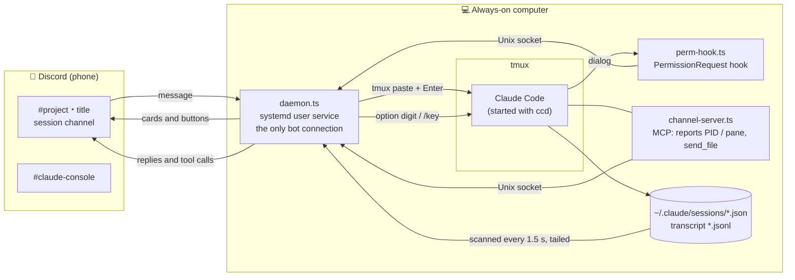

# Guide: driving Claude Code in tmux from Discord

**English** · [简体中文](guide.zh-CN.md)

This guide covers how this fork is meant to be used by default. You keep Claude Code running in tmux on a computer that stays on, **without Claude Code's channels**. From Discord on your phone you can then chat with it, approve permissions, answer its questions, approve plans, and start, resume or hand off sessions. The full command and configuration reference is in the [README](../README.md).

- [Why not channels](#why-not-channels)
- [How it fits together](#how-it-fits-together)
- [Install](#install)
- [Day-to-day workflow](#day-to-day-workflow)
- [What shows up on Discord](#what-shows-up-on-discord)
- [Rules for messages from Discord](#rules-for-messages-from-discord)
- [Configuration](#configuration)
- [Security](#security)
- [Troubleshooting](#troubleshooting)
- [Compatibility and limitations](#compatibility-and-limitations)
- [Development](#development)

## Why not channels

Upstream uses Claude Code's [channels](https://code.claude.com/docs/en/channels) to push Discord messages into a session and to relay permission prompts. Channels are a research preview behind a server-side switch. That switch is **only served to claude.ai logins and Console API keys**. You won't get it if either of these applies:

- you use a third-party API gateway (`ANTHROPIC_BASE_URL` plus `ANTHROPIC_AUTH_TOKEN`);
- you set `CLAUDE_CODE_DISABLE_NONESSENTIAL_TRAFFIC`.

Without the switch, Claude Code says:

```
--dangerously-load-development-channels ignored (server:discord-sync)
Channels are not currently available
```

Discord could then only watch. This fork uses two things that work with any login instead:

| Direction | How |
|---|---|
| Discord → session | The message is **pasted into the session's tmux pane** and Enter is pressed |
| Permissions, questions, plans → Discord | A **`PermissionRequest` hook**, while the terminal shows the same dialog |
| Any other dialog → Discord | The tmux screen is read, and its numbered options become buttons |

If your account does have channels, `"channels": true` brings back upstream's behaviour.

## How it fits together



- **Mirroring.** Every 1.5 s the daemon scans Claude Code's session registry, `~/.claude/sessions/<pid>.json`. It tails each session's transcript and posts prompts, replies and tool calls to that session's channel.
- **Input.** The daemon first checks three things: the session runs in tmux, its input line is on screen, and the input line is empty. Then it pastes the message in one bracketed paste and presses Enter.
- **Dialogs.** When a `ccd` session shows a permission prompt, a question or a plan:
  1. `perm-hook.ts` hands it to the daemon, which posts a card.
  2. If you press a button on Discord, the hook returns the decision to Claude Code and the terminal dialog closes.
  3. If the terminal answers first, the daemon sees the session stop `waiting`. It closes the card and ends the hook.
- **Network.** Nothing listens on a TCP port. The pieces talk over one Unix socket with mode 0600. The only network traffic is outbound, to Discord.

## Install

### 1. Discord

1. **Create a server that only you are in.** Click ＋, choose *Create My Own*, then *For me and my friends*. Don't invite anyone.
2. **Create the bot.** In the [Discord Developer Portal](https://discord.com/developers/applications), click **New Application**, then open **Bot**:
   - Click **Reset Token** and copy the token.
   - Turn on **Message Content Intent** and save.
   - To turn off **Public Bot**, first set **Installation → Install Link** to **None**. Otherwise saving fails with "Private application cannot have a default authorization link".
3. **Copy your user ID.** Turn on **Developer Mode** in Discord's *Settings → Advanced*. Then right-click your name and choose *Copy User ID*.

The setup wizard prints the invite link with every permission the bot needs. That includes **Manage Channels**, and **Manage Roles**, which is what makes session channels visible to you only.

4. **Set the server's notifications to *Only @mentions*** (long-press or right-click the server → *Notification Settings*). Cards that need you and "Claude is done" @-mention you, so the rest of the mirror stays quiet.

### 2. Dependencies and the wizard

You need [Bun](https://bun.sh) (on Arch / CachyOS: `sudo pacman -S bun`), tmux and git.

```bash
git clone https://github.com/numb747/claude-discord-sync.git
cd claude-discord-sync
bun install --frozen-lockfile     # exactly the locked versions; don't `bun update` (see Compatibility)
bun src/cli.ts setup
```

The wizard has five steps:

1. Asks for the bot token.
2. Asks which server to use. Open the invite link it prints to add the bot.
3. Asks for your user ID.
4. Creates the `~/.local/bin/ccd` link.
5. Installs and starts the systemd user service `claude-discord-sync`.

Then check:

```bash
systemctl --user status claude-discord-sync
journalctl --user -u claude-discord-sync -f     # expect "logged in as …" and "syncing into …"
bun src/cli.ts doctor                            # read-only check of the bot, permissions and sessions
```

> If Discord needs a proxy on your network: the daemon has no proxy setting, and `HTTPS_PROXY` has no effect on discord.js. A **TUN-mode transparent proxy** (sing-box, Clash) works.

## Day-to-day workflow

**At the computer.** Start Claude Code inside tmux with `ccd` instead of `claude`. Arguments go straight to `claude`, e.g. `ccd --resume`, `ccd --model opus`.

```bash
tmux new -s work
cd ~/project && ccd
```

A channel named `project・title` appears under *Claude Sessions*. Its first message says whether the session can be driven from Discord.

**Away, on your phone:**

| To | Do |
|---|---|
| Give Claude work | Post in the session channel. While Claude is busy, the message is queued until the current turn ends |
| See progress | The channel mirrors the session live. A "⏳ Working" status sits at the bottom while it works, and you get @-mentioned when it's done |
| Approve a command | Press *Allow*. *Always allow* also adds the rule the terminal offers as "don't ask again" |
| Refuse and redirect | Press *Deny and say why*, then write what to do instead |
| Answer a question | Pick from the select menu. *Other* lets you type an answer |
| Approve a plan | Press *Approve · auto-accept edits* or *Approve · review edits*. *Revise* sends feedback instead |
| Anything the cards don't cover | `/screen` shows the terminal. `/key 2`, `/key down enter` or `/key esc` press keys in it |
| Interrupt | `/stop` (presses Esc) |
| Start something new | `/new ~/some/dir [first message]` in the console channel. It starts `ccd` in a new tmux session |
| Continue an ended session | `/resume` in its channel, or pick it in the console |
| The context is filling up | `/handoff` writes a handoff document; a button starts a new session from it |
| Claude Code commands such as `/compact` | Post them as they are; they are typed in as is |

**Back at the computer.** Run `tmux attach`. It is the same session, so there is nothing to hand back. Background tasks and subagents Claude started while you were away kept running, because the session was this one interactive process all along.

## What shows up on Discord

| Card | When | Buttons |
|---|---|---|
| 🔐 Permission needed: tool | A `ccd` session shows a permission prompt | *Allow*, *Always allow*, *Deny*, *Deny and say why*. You can also reply `yes <code>` or `no <code>` |
| ❓ Question | Claude calls AskUserQuestion | A select menu per question, plus *Answer in terminal* |
| 📋 Plan awaiting approval | Claude calls ExitPlanMode | *Approve · auto-accept edits*, *Approve · review edits*, *Revise* |
| ⏸️ Claude is waiting on the terminal | Any other dialog, including in sessions started with plain `claude`, after 3 s of waiting (8 s for `ccd` sessions) | One button per numbered option, plus *Esc* |

A card's colour says where it stands:

- 🟨 yellow: waiting for you;
- 🟩 green: allowed or answered;
- 🟥 red: denied;
- 🟦 blue: plan sent back for revision;
- ⬜ grey: answered in the terminal, timed out, or gone.

When a card closes, its buttons go away and it records the outcome, e.g. "✅ Allowed (name)".

Permission cards show what the tool will do:

- Bash: the command;
- Write: the file and the start of its content;
- Edit: a diff;
- web tools: the URL;
- MCP tools: the server and the arguments.

The mirror also rewrites Markdown that Discord can't show. Tables become lists, headings below `###` become bold lines, and horizontal rules are dropped. Code blocks are left as they are.

## The console and channels

The **console** (`#claude-console`) lists every session with its status, with menus and buttons below. Three of them act on running sessions at once, so each first asks in a message only you can see; the red button goes ahead, "Cancel" changes nothing:

- **Pause all**: pauses sync for every session. Claude keeps working, but nothing from the paused stretch is posted, then or after resuming; permission prompts stay in the terminal; messages sent in the channels are refused. "Resume all" brings it back and doesn't ask.
- **Interrupt a working session**: the same as Esc in the terminal; the session stays open.
- **End a session**: interrupts it if it's working, then types `/exit`. It can be resumed later.

**Deleting a channel on Discord does not delete the Claude Code session.** The transcript lives on the computer under `~/.claude/projects/`; the channel is only a mirror. What deleting does:

- The channel of a **running** session: the daemon recreates it a few seconds later with the last 15 entries. The session itself is untouched. To keep it off Discord, pause it with `/sync off` instead.
- The channel of an **ended** session: the daemon forgets the session, and it leaves the console's resume menu. `claude --resume` on the computer still works, and resuming opens a new channel.

## Rules for messages from Discord

The daemon refuses to send a message, and says why, rather than type it somewhere it doesn't belong:

| Situation | Result |
|---|---|
| A dialog is open in the terminal | Refused: answer the dialog first |
| Someone has typed into the input line locally and not sent it | Refused; the reply quotes the draft |
| No input line on screen (a menu is open, or `!` shell mode) | Refused: check with `/screen`, close it with `/key esc` |
| The message starts with `!` but isn't a bot command | Refused, because Claude Code would run it as a shell command |
| The message starts with `/` | Typed in as is, so `/compact`, `/cost` and the like work remotely |
| The session isn't in tmux | The channel is read-only |
| A collaborator you shared the session with writes | The message is prefixed with `[Discord · name (role)]`, so it can never start with `!` or `/` |
| Attachments | Saved to `~/.claude/channels/discord-sync/inbox/`; their paths are appended to the message |

A message you send from Discord isn't echoed back as "👤 Local input".

## Configuration

Settings live in `~/.claude/channels/discord-sync/config.json`. This fork adds two keys:

| Key | Default | Meaning |
|---|---|---|
| `channels` | `false` | `true`: use Claude Code channels instead. This is upstream's behaviour and needs a claude.ai or Console login |
| `tmuxInput` | `"all"` (`"ccd"` with `channels: true`) | Which tmux sessions accept Discord input: `"all"` (plain `claude` too), `"ccd"` (only sessions started with `ccd`), or `"off"` (every session read-only) |

Upstream settings you're likely to want:

| Key | Meaning |
|---|---|
| `language` | `"en"`, `"zh-TW"` or `"zh-CN"` |
| `showToolCalls` | `false` stops posting tool call summaries, so less command output and file content is mirrored |
| `backlog` | How many past messages to post when a channel is created for a session that's already running |
| `notifyMinBusySec` | How long a turn must last (in seconds) before its end @-mentions you |

Restart the service after changing settings: `systemctl --user restart claude-discord-sync`.

## Security

- **Anyone in `allowFrom` can run any command on your computer through Claude.** Keep the allowlist to yourself, and keep the server to you and the bot.
- **Mirroring does no redaction.** Replies, tool calls, command output and file excerpts all go to Discord. For sensitive projects, set `showToolCalls` to `false`, or pause a session with `/sync off` in its channel (`/sync on` resumes).
- **`/new` and `/resume` from Discord accept the folder trust dialog**, so the folder's `.claude/` (hooks, MCP servers) is loaded. Only use them on folders you trust.
- **The token is stored in plain text** in `~/.claude/channels/discord-sync/.env`, mode 600. If it leaks, press *Reset Token* in the Developer Portal; the old token stops working immediately.
- **Only owners can use `/key`, `/screen` and the dialog buttons.** Dialog buttons also work for people with *full* access. `/key` only accepts keys from a whitelist.
- **No listening ports, no telemetry, no automatic updates.**

## Troubleshooting

| Symptom | Cause and fix |
|---|---|
| `Channels are not currently available` at startup | Your account has no channels, but `"channels": true` is set (or upstream's `ccd` is in use). Set it back to `false` (the default); `ccd` then doesn't load the channel and the warning goes away |
| The channel says read-only | The session isn't in tmux, or `tmuxInput` excludes it |
| "Not sent: …" after posting | The reply gives the reason (see the rules above). Usually a dialog is open or something is typed in the input line |
| A dialog is open but no card appears | Screen cards appear after 3 s of waiting (8 s for `ccd` sessions), and nothing is posted for 10 s after a dialog was answered from Discord. `/screen` always shows the screen |
| Claude doesn't respond and the terminal shows 429 | The API (or your gateway) is overloaded; this tool isn't involved. Let it retry, or start with another model (`ccd --model …`) |
| `syncing into` takes minutes after a restart | Too many restarts in a short time hit a Discord rate limit: channel topics can change twice per 10 minutes. It recovers on its own |
| `making Claude Sessions private failed: Missing Permissions` in the log | The bot lacks *Manage Roles*. Authorize it again with the wizard's invite link; it's fine that it's already in the server |
| New sessions use a different model after `/model` from Discord | That's Claude Code's `/model`: it saves the model to `~/.claude/settings.json`. For a one-off model, use `ccd --model …` |
| Nothing happens when posting in the console channel | The console isn't a session. Post in the session's own channel |

The most useful command when something is off:

```bash
journalctl --user -u claude-discord-sync -n 50 -o cat
```

## Compatibility and limitations

- **Tested on Claude Code 2.1.273** (Linux, tmux 3.8, Bun 1.4.3). A major Claude Code release may need adjustments in three places:
  - **Screen parsing.** The input line is found by `❯` and the inverse-video cursor, dialog options by `❯ 1.`. `test/terminal.test.ts` checks this against captured screens.
  - **Dialogs while the hook runs.** The terminal must keep showing its dialog while the `PermissionRequest` hook runs.
  - **Plan approval.** Approving a plan presses the terminal's option, because Claude Code ignores a hook's approval of ExitPlanMode.
- **Don't run `bun update`.** The locked MCP SDK negotiates protocol 2025-11-25. A newer SDK that negotiates 2026-07-28 may be silently left unregistered by Claude Code.
- **One side types at a time.** While you're typing locally, Discord messages are refused rather than mixed into your draft.
- **The transcript format is internal to Claude Code.** The mirror's rendering (`src/render.ts`) may need updates when it changes.

## Development

```bash
bunx tsc --noEmit        # typecheck
bun test                 # screen-parsing tests (test/fixtures are captured screens)
systemctl --user restart claude-discord-sync   # the daemon runs the checked-out source; restart after changes
```

- **Remotes.** `origin` is this fork; `upstream` is [Cnyn0403/claude-discord-sync](https://github.com/Cnyn0403/claude-discord-sync).
- **Following upstream.** Run `git fetch upstream && git rebase upstream/master`. Conflicts will mostly be in `src/daemon.ts` (input routing, cards) and `src/i18n.ts`. After rebasing, run the tests, and read upstream's changes for new outbound connections or loosened permissions.
- **Refreshing fixtures.** Start a test session in tmux and bring up the dialog you need. Save it with `tmux capture-pane -p` (add `-e` for input-line fixtures) into `test/fixtures/`. Replace personal paths first.
- **Don't use `/model` in test sessions**; see Troubleshooting.
