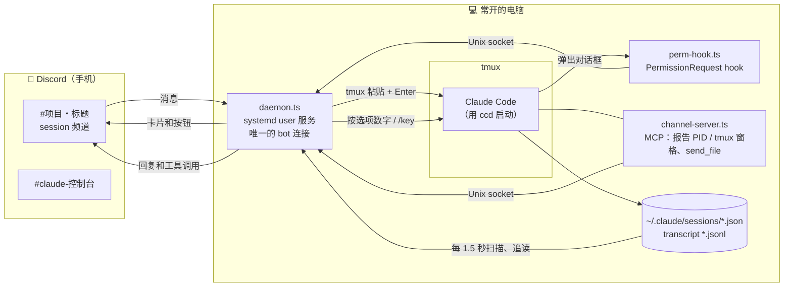

# 使用指南：用 Discord 远程驱动 tmux 里的 Claude Code

[English](guide.md) · **简体中文**

这份指南面向这个 fork 的默认用法：**不依赖 Claude Code 的 channels**，在一台常开的电脑上把 Claude Code 跑在 tmux 里，用手机 Discord 远程对话、批准权限、回答选择题、审批计划，以及新建、恢复和交接 session。完整的命令表和配置项见 [README](../README.zh-CN.md)。

- [为什么不用 channels](#为什么不用-channels)
- [整体结构](#整体结构)
- [安装](#安装)
- [日常工作流](#日常工作流)
- [Discord 上会看到什么](#discord-上会看到什么)
- [从 Discord 发消息的规则](#从-discord-发消息的规则)
- [配置](#配置)
- [安全](#安全)
- [故障排查](#故障排查)
- [兼容性与已知限制](#兼容性与已知限制)
- [开发与维护](#开发与维护)

## 为什么不用 channels

上游版本靠 Claude Code 的 [channels](https://code.claude.com/docs/en/channels) 把 Discord 消息推进 session，并转发权限确认。channels 目前是 research preview，是否开放由服务端开关决定，**只对 claude.ai 登录或 Console API key 下发**。下面两种情况拿不到这个开关：

- 用第三方 API 中转（设置了 `ANTHROPIC_BASE_URL` 和 `ANTHROPIC_AUTH_TOKEN`）；
- 设置了 `CLAUDE_CODE_DISABLE_NONESSENTIAL_TRAFFIC`。

这时启动会提示：

```
--dangerously-load-development-channels ignored (server:discord-sync)
Channels are not currently available
```

结果是 Discord 只能看、不能操作。这个 fork 改成用两样任何登录方式都有的东西：

| 方向 | 做法 |
|---|---|
| Discord → session | 把消息**粘贴到 session 所在的 tmux 窗格**并回车 |
| 权限、选择题、计划 → Discord | Claude Code 的 **`PermissionRequest` hook**，终端里同时照常显示同一个对话框 |
| 其他对话框 → Discord | 读 tmux 屏幕，把编号选项做成按钮 |

如果你的账号能用 channels，在配置里写 `"channels": true` 就会恢复上游的行为。

## 整体结构



- **镜像**：daemon 每 1.5 秒扫描 Claude Code 的会话注册表 `~/.claude/sessions/<pid>.json`，追读每个 session 的 transcript，把用户输入、回复、工具调用发到它的频道。
- **输入**：daemon 先确认 session 在 tmux 里、屏幕上有输入行、输入行是空的，然后用一次 bracketed paste 粘贴进去，再按 Enter。
- **对话框**：
  1. 用 `ccd` 启动的 session 弹出权限、选择题或计划时，`perm-hook.ts` 把内容交给 daemon，daemon 发卡片。
  2. 在 Discord 上点按钮后，hook 把决定交还 Claude Code，终端里的对话框随之关闭。
  3. 如果先在终端回答，daemon 看到 session 不再处于 `waiting`，就关闭卡片并结束 hook。
- 整个过程**不监听任何 TCP 端口**，只用一个权限为 0600 的 Unix socket，对外只有到 Discord 的出站连接。

## 安装

### 1. 准备 Discord

1. 新建一个**只有你自己**的服务器：点左侧的 ＋，选“亲自创建”，再选“供我和我的朋友使用”。不要邀请别人。
2. 打开 [Discord Developer Portal](https://discord.com/developers/applications)，点 **New Application**。然后进入 **Bot** 页：
   - 点 **Reset Token**，复制 token 备用。
   - 打开 **Message Content Intent**，然后保存。
   - 如果想关掉 **Public Bot**：先到 **Installation** 页把 **Install Link** 改成 **None**，否则保存时会报“私密 APP 无法拥有默认授权关联”。
3. 在 Discord 里进入“设置 → 高级”，打开**开发者模式**。然后右键自己的头像，选“复制用户 ID”。

邀请链接由安装向导生成，它带着全部需要的权限，包括**管理频道**和**管理身份组**。后者用来把 session 频道设成只有你能看到。

4. **手机通知建议设成“仅 @提及”**：在服务器名上长按（或右键），进入“通知设置”。需要你处理的卡片和“Claude 完成了”都会 @你，其他镜像消息就不会一直响。

### 2. 装依赖并运行向导

需要 [Bun](https://bun.sh)（Arch / CachyOS 上运行 `sudo pacman -S bun`）、tmux 和 git。

```bash
git clone https://github.com/numb747/claude-discord-sync.git
cd claude-discord-sync
bun install --frozen-lockfile     # 严格按锁文件安装，不要 bun update（见“兼容性”）
bun src/cli.ts setup               # 语言选 3（简体中文）
```

向导共五步：

1. 填 token；
2. 选服务器（打开它给出的邀请链接，把 bot 拉进服务器）；
3. 填你的用户 ID；
4. 建 `~/.local/bin/ccd` 链接；
5. 安装 systemd user 服务 `claude-discord-sync`，并设为开机自启。

装完检查一下：

```bash
systemctl --user status claude-discord-sync
journalctl --user -u claude-discord-sync -f     # 应看到 logged in as …、syncing into …
bun src/cli.ts doctor                            # 只读检查 bot、权限和 session
```

> 国内网络下 Discord 需要代理。daemon 没有内置代理配置，但 sing-box、Clash 这类 **TUN 透明代理**可以直接用。注意 `HTTPS_PROXY` 环境变量对 discord.js 无效。

## 日常工作流

**在电脑上：** 在 tmux 里用 `ccd` 代替 `claude` 启动。参数原样传给 `claude`，例如 `ccd --resume`、`ccd --model opus`。

```bash
tmux new -s work
cd ~/project && ccd
```

Discord 上的“Claude Sessions”分类下会出现这个 session 的频道，名字是“项目・标题”。频道开头一条消息写明了这个 session 能否从 Discord 操作。

**离开电脑后，在手机上：**

| 想做的事 | 操作 |
|---|---|
| 让 Claude 干活 | 在 session 频道直接发消息。它正在忙时，消息会排到当前这一轮之后 |
| 看它做到哪了 | 频道会实时镜像。忙的时候底部有一条“⏳ 工作中”状态；做完会 @你 |
| 批准一个命令 | 点卡片上的“允许”。点“始终允许”会把终端里“不再询问”那条规则加进去 |
| 拒绝并指路 | 点“拒绝并说明”，写上该怎么做 |
| 回答选择题 | 在下拉菜单里选；选“其他”可以自由填写 |
| 审批计划 | “批准・自动接受编辑”“批准・逐个确认编辑”，或者点“继续修改”写修改意见 |
| 卡片覆盖不到的情况 | 用 `/screen` 看终端画面，用 `/key 2`、`/key down enter`、`/key esc` 按键 |
| 打断它 | `/stop`（相当于按 Esc） |
| 开新活 | 在控制台频道运行 `/new ~/某目录 [第一句话]`，会在新的 tmux session 里启动 `ccd` |
| 接着上次的 session | 在已结束 session 的频道里运行 `/resume`，或在控制台里选 |
| 上下文快满了 | `/handoff` 生成交接文档，再一键开一个新 session 接着做 |
| 压缩上下文等 Claude Code 命令 | 直接发 `/compact`，会原样输入进去 |

**回到电脑前：** 运行 `tmux attach`，看到的就是同一个 session，不需要任何交接。Claude 在你离开期间开的后台任务和子代理一直在跑，因为 session 从头到尾都是这个交互式进程。

## Discord 上会看到什么

| 卡片 | 什么时候出现 | 按钮 |
|---|---|---|
| 🔐 需要权限：工具名 | `ccd` session 弹出权限确认 | 允许 / 始终允许 / 拒绝 / 拒绝并说明，也可以回复 `yes 代码` 或 `no 代码` |
| ❓ 选择题 | Claude 调用 AskUserQuestion | 每题一个下拉菜单，外加“改在终端回答” |
| 📋 计划待确认 | Claude 调用 ExitPlanMode | 批准・自动接受编辑 / 批准・逐个确认编辑 / 继续修改 |
| ⏸️ Claude 正在等终端 | 其他对话框（包括普通 `claude` 启动的 session），等待超过 3 秒才发（`ccd` 启动的 session 为 8 秒） | 屏幕上每个编号选项一个按钮，外加 Esc |

卡片的左边框颜色表示状态：🟨 黄色是等你回答，🟩 绿色是已允许或已回答，🟥 红色是已拒绝，🟦 蓝色是计划被要求修改，⬜ 灰色是已在终端回答、已超时或已关闭。关闭时卡片底部会写明结果，例如“✅ 已允许（你的名字）”，按钮随之消失。

权限卡片会按工具显示要做的事：Bash 显示命令，Write 显示文件路径和内容开头，Edit 显示删改对比，网页请求显示网址，MCP 工具显示服务名和参数。

镜像时还会做几处转换，因为 Discord 不支持这些写法：Markdown 表格改成列表，`####` 以下的标题改成粗体，分隔线去掉。代码块里的内容保持原样。

## 控制台和频道

**控制台**（`#claude-控制台`）列出所有 session 的状态，下面有几个菜单和按钮。其中三个一点就会影响正在运行的 session，所以都会先弹一条只有你看得见的确认，点红色按钮才执行，点“取消”什么都不改：

- **全部暂停**：暂停所有 session 的同步。Claude 照常工作，但暂停期间的输出不会发到 Discord，恢复后也不补发；权限请求只出现在终端；在频道里发的消息会被拒绝。点“全部恢复”就回来了，恢复不需要确认。
- **中断工作中的 session**：等同在终端按 Esc，session 不会关掉。
- **结束 session**：先中断（如果正在工作），再输入 `/exit`。之后可以恢复。

**在 Discord 上手动删掉频道不会删掉 Claude Code 的 session。** 对话记录在电脑上的 `~/.claude/projects/` 里，Discord 频道只是镜像。删频道的效果是：

- 删的是**正在运行**的 session 的频道：守护进程几秒后重建一个，带最近 15 条记录。session 本身不受影响。想让它从 Discord 上消失，用 `/sync off` 暂停它，而不是删频道。
- 删的是**已结束**的 session 的频道：守护进程就此忘掉这个 session，控制台的“恢复”菜单里也不再有它。在电脑上照样能 `claude --resume`，恢复后会新开一个频道。

## 从 Discord 发消息的规则

daemon 宁可拒绝发送并告诉你原因，也不会把字打到不该去的地方：

| 情况 | 结果 |
|---|---|
| 终端正开着对话框 | 拒绝，提示先回答对话框 |
| 输入行里有人在本地打字、还没发出（包括多行） | 拒绝，并显示草稿内容 |
| 输入行里是刚被中断退回的上一条消息（Claude 还没回答就被中断时，终端会把它放回输入框） | 先清掉它，再发新消息。那条已经发过，算不上草稿 |
| 屏幕上找不到输入行（开着菜单，或处于 `!` shell 模式） | 拒绝，提示先用 `/screen` 看、用 `/key esc` 关掉 |
| 消息以 `!` 开头但不是 bot 命令 | 拒绝，因为 Claude Code 会把开头的 `!` 当作 shell 命令执行 |
| 消息以 `/` 开头 | 照常输入，所以 `/compact`、`/cost` 等可以远程用 |
| session 不在 tmux 里 | 只读 |
| 你分享了 session 的协作者发的消息 | 前面会加上 `[Discord · 名字 (身份)]`，所以不可能以 `!` 或 `/` 开头 |
| 附件 | 下载到 `~/.claude/channels/discord-sync/inbox/`，路径附在消息末尾 |

你从 Discord 发的消息不会再以“👤 本地输入”的形式回显一遍。

## 配置

配置文件是 `~/.claude/channels/discord-sync/config.json`。这个 fork 新增了两个配置项：

| 键 | 默认 | 说明 |
|---|---|---|
| `channels` | `false` | `true` 表示改用 Claude Code channels（需要 claude.ai 或 Console 登录），也就是上游原来的行为 |
| `tmuxInput` | `"all"`（`channels: true` 时为 `"ccd"`） | 哪些 tmux 里的 session 接受 Discord 输入：`"all"` 包括普通 `claude`，`"ccd"` 只接受 `ccd` 启动的，`"off"` 全部只读 |

常用的上游配置项：

| 键 | 说明 |
|---|---|
| `language` | `"zh-CN"`、`"zh-TW"` 或 `"en"` |
| `showToolCalls` | `false` 时不发工具调用摘要，可以少镜像一些命令输出和文件内容 |
| `backlog` | 给已经在跑的 session 建频道时，补发多少条历史 |
| `notifyMinBusySec` | 一轮至少工作多少秒，做完才 @你 |

改配置后需要重启服务：`systemctl --user restart claude-discord-sync`。

## 安全

- **`allowFrom` 里的人可以通过 Claude 在你的电脑上执行任意命令。** 白名单只放你自己，服务器只留你和 bot。
- 镜像**不做脱敏**：回复、工具调用、命令输出、文件片段都会发到 Discord。处理敏感项目时把 `showToolCalls` 设成 `false`，或者在 session 频道里用 `/sync off` 暂停同步（`/sync on` 恢复）。
- 从 Discord 运行 `/new`、`/resume` 时，daemon 会自动选“信任此文件夹”，于是该目录下的 `.claude/`（hooks、MCP 配置）会被加载。只对你信任的目录这么做。
- token 以明文存在 `~/.claude/channels/discord-sync/.env`，权限是 600。泄露了就去 Developer Portal 点 Reset Token，旧的会立刻作废。
- `/key`、对话框按钮、`/screen` 只有所有者能用（对话框按钮还包括被授予“完整”权限的人）。`/key` 只接受白名单里的按键。
- 不监听任何端口，没有遥测，没有自动更新。

## 故障排查

| 现象 | 原因和处理 |
|---|---|
| 启动时提示 `Channels are not currently available` | 账号拿不到 channels，而配置里写了 `"channels": true`（或者用的是上游的 `ccd`）。改回 `false`（默认值）后，`ccd` 不再加载 channel，这条提示就不会再出现 |
| 频道里显示“只读” | session 不在 tmux 里，或者 `tmuxInput` 把它排除了 |
| 发消息后回复“没有发出” | 看回复里写的原因（见上面的规则表）。通常是终端开着对话框，或输入行里有草稿 |
| 有对话框但 Discord 上没有卡片 | 截图卡片要等待 3 秒后才发（`ccd` 启动的 session 为 8 秒）；刚在 Discord 上回答过的话，会再静默 10 秒。随时可以用 `/screen` 看 |
| Claude 没反应、终端里显示 429 | 中转或服务端过载，与本工具无关。等它重试，或换一个模型启动（`ccd --model …`） |
| 重启后好几分钟才出现 `syncing into` | 短时间内重启太多次，触发了 Discord 的频率限制（频道话题 10 分钟只能改 2 次），等它恢复即可 |
| 日志里有 `making Claude Sessions private failed: Missing Permissions` | bot 缺“管理身份组”权限。用向导给的链接重新授权一次（bot 已在服务器里也没关系） |
| 在 Discord 用 `/model` 后，以后的新 session 也变了模型 | 这是 Claude Code `/model` 自身的行为：它会写进 `~/.claude/settings.json`。只想临时换模型，就在启动时用 `ccd --model …` |
| 在 `#claude-控制台` 发消息没反应 | 控制台不对应任何 session，要在 session 自己的频道里发 |

排查时最有用的命令：

```bash
journalctl --user -u claude-discord-sync -n 50 -o cat
```

## 兼容性与已知限制

- 在 **Claude Code 2.1.273**（Linux、tmux 3.8、Bun 1.4.3）上实测过。以下几点依赖 Claude Code 当前的行为，大版本更新后可能需要调整：
  - 屏幕解析：输入行的 `❯` 和反色光标、对话框的 `❯ 1.` 编号。`test/terminal.test.ts` 用实际截下的屏幕做回归测试。
  - `PermissionRequest` hook 运行时终端照常显示对话框。
  - 计划的批准要靠在终端按选项，因为 Claude Code 不接受 hook 对 ExitPlanMode 的批准。
- **不要运行 `bun update`。** 锁定的 MCP SDK 协商的协议版本是 2025-11-25。新版 SDK 如果协商 2026-07-28，Claude Code 可能直接不注册这个 MCP 服务，而且不会报错。
- 一个 session 同一时间只能有一边在输入。本地正在打字时，Discord 的消息会被拒绝，而不是插进你的草稿里。
- transcript 格式是 Claude Code 的内部格式，镜像的渲染（`src/render.ts`）可能需要跟着更新。

## 开发与维护

```bash
bunx tsc --noEmit        # 类型检查
bun test                 # 屏幕解析测试（test/fixtures 是实际截下的屏幕）
systemctl --user restart claude-discord-sync   # daemon 直接运行检出的源码，改完要重启
```

- 仓库的 remote：`origin` 是这个 fork，`upstream` 是 [Cnyn0403/claude-discord-sync](https://github.com/Cnyn0403/claude-discord-sync)。
- 同步上游：运行 `git fetch upstream && git rebase upstream/master`。主要冲突会集中在 `src/daemon.ts`（输入路由、卡片）和 `src/i18n.ts`。合并后先跑一遍测试，再读一遍上游的改动，确认没有新增外联或权限放宽。
- 更新屏幕素材：在 tmux 里开一个测试 session，触发对应的对话框，然后用 `tmux capture-pane -p`（输入行素材要加 `-e`）存到 `test/fixtures/`。注意先把路径里的个人信息替换掉。
- 测试 session 里不要用 `/model`，原因见上面的故障排查表。
